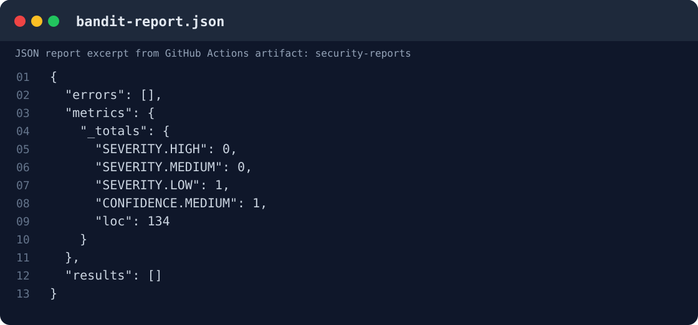
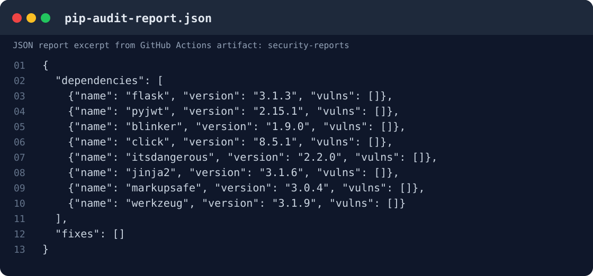

# Secure Notes API

Небольшой REST API для хранения личных заметок. Сделала его для первой лабораторной по информационной безопасности, чтобы на простом примере реализовать авторизацию и несколько базовых мер защиты.

Проект написан на Python с Flask. Данные пользователей и заметки хранятся в SQLite, запросы и ответы API передаются в JSON.

## Что умеет API

| Метод | URL | Описание | Нужен JWT |
| --- | --- | --- | --- |
| `POST` | `/auth/register` | Регистрация пользователя | Нет |
| `POST` | `/auth/login` | Вход и получение токена | Нет |
| `GET` | `/api/data` | Получение своих заметок | Да |
| `POST` | `/api/data` | Добавление заметки | Да |

Для обращения к защищённым методам нужно передать токен в заголовке `Authorization: Bearer <token>`.

## Запуск

Понадобится Python 3.12 и установленные зависимости.

```bash
python3 -m venv .venv
source .venv/bin/activate
python -m pip install -r requirements-dev.txt
```

Перед запуском нужно задать секрет для подписи JWT:

```bash
export JWT_SECRET="$(python -c 'import secrets; print(secrets.token_urlsafe(48))')"
python -m src.app
```

После запуска API доступен по адресу `http://127.0.0.1:5000`. База SQLite создаётся автоматически. Здесь используется локальный HTTP только для тестирования; для публичного развёртывания нужен HTTPS.

## Примеры запросов

**Регистрация** — `POST /auth/register`

```json
{
  "username": "alice",
  "password": "VeryStrong!Pass123"
}
```

При успешной регистрации сервер возвращает `201 Created`.

**Вход** — `POST /auth/login`

```json
{
  "username": "alice",
  "password": "VeryStrong!Pass123"
}
```

В ответе `200 OK` приходит `access_token` — JWT, который нужно использовать для запросов к `/api/data`.

**Добавление заметки** — `POST /api/data`

Заголовок: `Authorization: Bearer <token>`

```json
{
  "content": "My first note"
}
```

Ответ: `201 Created`.

**Получение заметок** — `GET /api/data`

Заголовок: `Authorization: Bearer <token>`

```json
{
  "items": [
    {
      "id": 1,
      "content": "My first note"
    }
  ]
}
```

Если токен не передать или он некорректный, сервер вернёт `401 Unauthorized`.

## Что сделано для безопасности

### SQL Injection

В запросах к SQLite я использую параметры, а не подставляю данные из запроса в строку SQL. Например, при входе пользователь ищется так:

```python
user = db().execute(
    "SELECT id, password_hash FROM users WHERE username = ?",
    (body["username"],),
).fetchone()
```

Введённая строка становится значением параметра `?`, поэтому конструкция `alice' OR 1=1 --` не выполняется как SQL-код. При проверке такого логина сервер возвращает `401 Invalid credentials`.

### XSS

При возврате текста заметок вызывается `html.escape(value, quote=True)` из `src/security.py`. Например, строка `<script>alert('xss')</script>` превращается в `&lt;script&gt;alert(&#x27;xss&#x27;)&lt;/script&gt;`. Кроме того, API отдаёт `application/json` и заголовки `X-Content-Type-Options: nosniff`, `Content-Security-Policy: default-src 'none'; frame-ancestors 'none'` и `Cache-Control: no-store`. Если к API подключить интерфейс, в нём тоже нужно безопасно выводить текст, а не вставлять его в HTML как код.

### Аутентификация и хранение паролей

При регистрации пароль проходит проверку длины и сохраняется только как хэш `scrypt` с солью, который создаётся через Werkzeug. Сам пароль в SQLite не записывается. При входе `check_password_hash()` сравнивает введённый пароль с хэшем из базы.

После успешного входа сервер выдаёт подписанный JWT с алгоритмом `HS256` на 20 минут. В токене есть `sub` (идентификатор пользователя), `iat`, `exp`, `iss` и `aud`. На `GET /api/data` и `POST /api/data` декоратор `authorized` проверяет формат `Bearer`, подпись, алгоритм, срок действия, issuer, audience и наличие обязательных полей. Неверный, просроченный или отсутствующий токен даёт `401`. Секрет подписи передаётся через `JWT_SECRET` и не хранится в репозитории.

Запросы заметок дополнительно фильтруются по `user_id`, взятому из проверенного токена, поэтому один пользователь не получает заметки другого.

## Тесты

Для API написаны тесты на `pytest`: регистрация и вход, доступ без токена, неправильный пароль, SQL Injection, XSS, разделение заметок пользователей и некорректные данные.

Запуск:

```bash
python -m pytest -q
```

## CI/CD

В `.github/workflows/ci.yml` настроен workflow `api check`. Он запускается при `push` и `pull_request` и выполняет:

1. Установку зависимостей.
2. Тесты `pytest`.
3. Анализ Python-кода с помощью `Bandit` (SAST).
4. Проверку зависимостей с помощью `pip-audit` (SCA).
5. Сохранение JSON-отчётов в артефакт `security-reports`.

Результаты запусков находятся в [GitHub Actions](https://github.com/mrcdssclss/infosec_lab1/actions).

## Структура проекта

- `src/app.py` — маршруты API, работа с SQLite и проверка JWT.
- `src/security.py` — проверка данных, хэширование паролей и экранирование текста.
- `tests/test_api.py` — тесты API.
- `.github/workflows/ci.yml` — автоматические проверки.
- `requirements.txt` и `requirements-dev.txt` — зависимости.

## Скриншоты проверок

Отчёты взяты из артефакта `security-reports`, сформированного GitHub Actions при успешном запуске `api check #5` (08.11.2026).

**Bandit (SAST):** при выбранных порогах `-ll -ii` список `results` пустой, ошибок сканирования нет. В общих метриках присутствует одна находка низкой серьёзности, отфильтрованная установленным порогом.



**pip-audit (SCA):** проверены 8 зависимостей, известных уязвимостей не обнаружено.



[GitHub Actions - api check](https://github.com/mrcdssclss/infosec_lab1/actions/workflows/ci.yml)